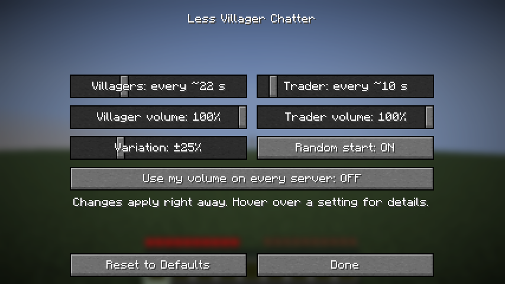

# Less Villager Chatter

A trading hall with twenty villagers is loud. Each one says "hmm" about every 6 seconds, so a busy village never goes quiet. This mod makes villagers and the wandering trader talk less often, and quieter if you want.

It runs on the server. Players join with a normal vanilla client and install nothing.

**Download 1.0.2:** the [v1.0.2 release](https://github.com/valcheffnet/less-villager-chatter/releases/tag/v1.0.2) has a jar for each loader and Minecraft version, named `less-villager-chatter-<loader>-<minecraft>-1.0.2.jar`. Older versions are on the [releases page](https://github.com/valcheffnet/less-villager-chatter/releases), and the mod is also on [CurseForge](https://www.curseforge.com/minecraft/mc-mods/less-villager-chatter) and [Modrinth](https://modrinth.com/mod/less-villager-chatter).

**Bugs or ideas?** Open an [issue](https://github.com/valcheffnet/less-villager-chatter/issues) here, or come to [Discord](https://discord.com/invite/X6yxJpk9Fz) if you'd rather just talk.

## What it changes

In vanilla, a villager waits at least 4 seconds after each idle "hmm", then the chance of the next one grows every tick. That averages out to one sound every 6 seconds. The mod makes the wait longer:

| | Default | Vanilla |
|---|---|---|
| Villagers | one "hmm" every ~22 s | ~6 s |
| Wandering trader | one "hmm" every ~10 s | ~6 s |

Longer silences have a catch. Villagers that load at the same moment stay in step and then all "hmm" together. Two settings break that up:

- Random start puts each villager at a random point of its cycle when it loads.
- Variation makes every silence randomly up to 25% shorter or longer. The average does not change.

You can also lower the volume of all villager sounds and all wandering trader sounds, each with its own slider.

Other mobs are left alone. Work sounds and the yes/no sounds while trading still play, at the volume you pick.

## Singleplayer

On NeoForge, open Mods, select Less Villager Chatter and press Config. On Fabric, install [Mod Menu](https://modrinth.com/mod/modmenu) first, then do the same through its Mods screen. Chnages apply right away. Without a settings screen the mod works the same and reads its config file.



## Servers

Drop the jar into the server's `mods` folder. The settings are in `config/lessvillagerchatter.properties`, which the mod creates on first start. Restart the server after editing it.

```properties
# Ticks of silence after each "hmm" (20 ticks = 1 second)
villagerInterval=400
traderInterval=160
randomStart=true
# Percent, 0 to 90
variation=25
# Percent, 0 to 100
villagerVolume=100
traderVolume=100
# Client only, see below
useOwnVolume=false
```

The average time between sounds is about (interval + 40) / 20 seconds. 160 gives ~10 s, 400 gives ~22 s and 600 gives ~32 s.

The server's volume reaches vanilla clients through the sound packets. The hurt sound is the one exception: the client plays it on its own, so only players who have the mod hear it quieter.

## Your own volume on any server

With the mod on your client, turn on "Use my volume on every server". From then on you hear villagers and traders at your own volume on every server, whether it runs the mod or not.

## Versions

| Minecraft | Loaders | Java |
|---|---|---|
| 1.20.1 | Fabric, Forge | 17 |
| 1.21.1 | Fabric, NeoForge | 21 |
| 1.21.11 | Fabric, NeoForge | 21 |
| 26.1.2 | Fabric, NeoForge | 25 |
| 26.2 | Fabric, NeoForge | 25 |
| 26.3 | Fabric, NeoForge | 25 |

Pick the file for your Minecraft version and loader. On Fabric, Fabric API is not needed and Mod Menu is optional, only for the settings screen.

## Building from source

```
./gradlew build
```

Every loader and Minecraft version is its own Gradle project under `versions/` (for example `versions/fabric-1.20.1`), built from the same sources in `src/`. The few places where Minecraft changed between versions live in `compat/`. Each jar ends up in `versions/<loader>-<minecraft>/build/libs`.

`./gradlew :fabric-1.20.1:runSmokeTest` starts a dedicated server for that target, checks the mod and exits; every target has it. For the obfuscated versions (1.21.11 and older), `prodSmokeTest` runs the same checks on a real Fabric or Forge server with the release jar. `runClientSmokeTest` starts a client, opens the settings screen the way the loader's mod list does, moves the sliders, checks the saved config and the client volume option, takes two screenshots and exits. `./gradlew :fabric-26.3:runClientGameTest` also creates a singleplayer world and checks the mod there.

## License

All rights reserved, with permission to use the mod in modpacks. See [LICENSE.md](LICENSE.md).
